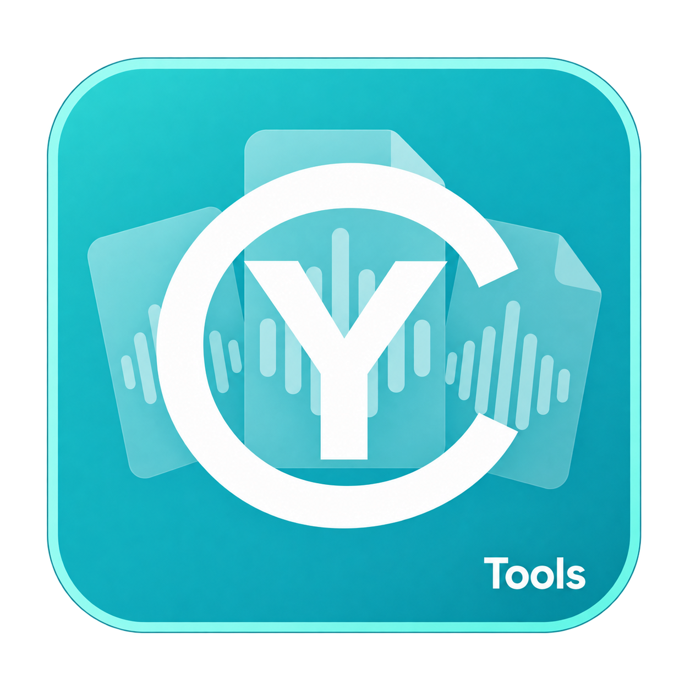
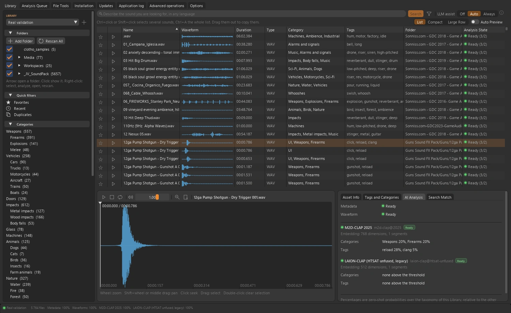
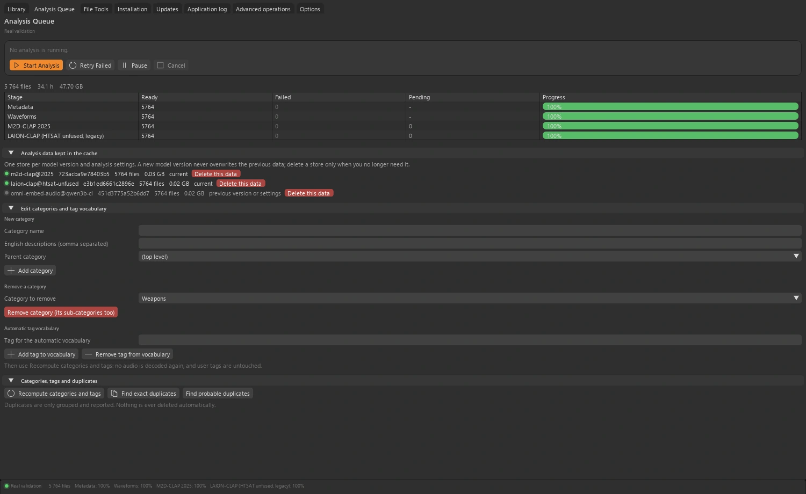

<table width="100%">
  <tr>
    <td width="300" align="left" valign="top">
      <a href="https://mrmybal.github.io/CyTools_AudioLibrary/?lang=fr">Site web</a><br>
      <a href="https://mrmybal.github.io/CyTools_AudioLibrary/Documentation.html#/fr/overview">Documentation</a><br>
      <a href="https://github.com/MrMybal/CyTools_AudioLibrary">GitHub</a><br><br>
      <sub>README</sub><br>
      <a href="README.md">English</a> · <a href="README.fr.md">Français</a>
    </td>
    <td width="400" align="center" valign="middle">
      <a href="https://mrmybal.github.io/CyTools_AudioLibrary/?lang=fr"></a>
    </td>
    <td width="300" align="right" valign="top">
      <p><sub>Licence de l’application</sub><br><a href="LICENSE"><strong>GPL-3.0-only</strong></a></p>
      <p><sub>Version de l’application</sub><br><a href="VERSION.fr.md"><strong>0.1.5</strong></a><br><strong>EXPÉRIMENTAL</strong></p>
      <p><a href="https://github.com/MrMybal/CyTools_AudioLibrary/releases/download/v0.1.5/CyTools_AudioLibrary-0.1.5-windows-x64.zip"><strong>Télécharger</strong></a><br><sub>Windows x64 · portable</sub></p>
    </td>
  </tr>
</table>

<h1 align="center">CyTools AudioLibrary</h1>

Maintenance : **Cyberalien**.


Explorez votre collection sonore avec les formes d’onde, les tags et la recherche en langage naturel. Vos dossiers restent à leur place. Pour les sound designers, les monteurs et toute personne qui travaille avec une collection de sons.

> **EXPÉRIMENTAL · 0.1.5**
>
> Version Windows publiée pour évaluation ; certains parcours des moteurs restent à valider. Consultez les [notes de version et limites connues](VERSION.fr.md).

[](website/assets/showcase/library.webp)

*Bibliothèque · dossiers, liste des sons, forme d’onde et analyse.*


## L’application

### Votre collection

Ajoutez des dossiers sonores, parcourez leur arborescence et écoutez depuis la forme d’onde. Les données d’analyse restent dans le cache de votre choix, séparées des originaux.

### Recherche sémantique

Les modèles compatibles recherchent dans la collection. Avec plusieurs modèles actifs, leurs classements sont fusionnés sans mélanger des embeddings incompatibles. Un assistant local facultatif peut reformuler la demande avant la recherche.

### Analyse et organisation

Suivez les étapes dans la file d’analyse, mettez le travail en pause ou reprenez-le et gérez les données propres à chaque modèle. Vos tags, catégories, notes et favoris sont préservés pendant l’analyse.

[](website/assets/showcase/queue.webp)

*File d’analyse · progression, données conservées et vocabulaire de tags.*


## Fonctionnalités

- **Gestion de collection :** références de dossiers, lecture sur forme d’onde, filtres, tags, catégories, notes, évaluations et favoris sur un son, une sélection ou un dossier.
- **Recherche sémantique :** parcours M2D-CLAP, LAION-CLAP et Omni-Embed-Audio compatibles ; fusion des classements sans mélanger les embeddings des modèles.
- **Préparation des requêtes :** CySearchAssist-CLAP reformule facultativement la demande pour la recherche audio. Son modèle s’installe séparément.
- **File d’analyse :** pause/reprise, données par modèle, vocabulaire de tags et synchronisation des dossiers en arrière-plan. L’analyse préserve vos annotations.
- **Livraison des fichiers :** export de copies en bundles ou glisser vers les applications compatibles. Après confirmation explicite, les outils fichiers peuvent renommer ou écrire des métadonnées, avec sauvegarde et annulation adaptées.

**Application et automatisation :** l’anglais est la langue par défaut ; le français se choisit dans Options. Enregistrez/chargez les configurations, consultez les journaux copiables et utilisez les opérations déclarées par CLI ou MCP. Le [manuel](https://mrmybal.github.io/CyTools_AudioLibrary/Documentation.html#/fr/overview) décrit les paramètres et contrats de sortie réels.

---

## Installation

La version applicative publiée est pour **Windows x64**. Le ZIP portable inclut son Python privé et les dépendances de base de l’interface et des médias. Les modèles et moteurs lourds facultatifs se téléchargent séparément.

1. [Téléchargez CyTools AudioLibrary 0.1.5](https://github.com/MrMybal/CyTools_AudioLibrary/releases/download/v0.1.5/CyTools_AudioLibrary-0.1.5-windows-x64.zip).
2. Extrayez le ZIP complet dans un dossier accessible en écriture. Gardez `app/` et `runtime/` à côté du lanceur.
3. Lancez **CyTools_AudioLibrary.exe**. Utilisez l’espace d’installation/modèles pour les composants nécessaires ; consultez leurs licences et conditions d’accès avant le téléchargement.

Aucun Python système n’est nécessaire pour ouvrir le portable. L’installation depuis les sources et certains moteurs facultatifs nécessitent des outils supplémentaires comme Git. Conservez le dossier complet ; l’exécutable seul ou le ZIP de mise à jour `app` ne constitue pas une installation complète.

Windows x64 est testé ; le lanceur Linux n’est pas validé. La recherche sémantique nécessite des modèles compatibles et le moteur IA installés séparément. Certaines licences de modèles restreignent l’usage commercial. Les outils fichiers peuvent renommer ou écrire des métadonnées uniquement sur demande explicite.

### Mises à jour et données

Pour une installation compatible existante, utilisez Mises à jour et le paquet applicatif correspondant. Préservez `data/`, les moteurs et les modèles. Ne forcez pas une mise à jour destinée à un autre ABI. Si le runtime requis change, installez le portable complet dans un dossier séparé et suivez la migration.

## Sources, compilation et bibliothèques nécessaires

<details>
<summary>Installation des sources Windows et outils de compilation facultatifs</summary>


Utilisez Python **3.11** pour l’environnement de base depuis les sources. Git sert au clonage et aux dépendances Git épinglées. Compiler le lanceur nécessite les Build Tools MSVC x64 et une invite développeur.

```powershell
git clone https://github.com/MrMybal/CyTools_AudioLibrary.git
cd CyTools_AudioLibrary
powershell -File app\Install.ps1
powershell -File app\build_launcher.ps1
.\CyTools_AudioLibrary.exe
```

Les dépendances de base exactes sont dans [app/requirements.txt](app/requirements.txt). Les moteurs utilisent leurs propres environnements et catalogues ; installer la base ne les installe pas. Consultez le [guide développeur](app/README.md) pour la compilation détaillée et les composants facultatifs.

</details>

---

## Licence

**CyTools AudioLibrary utilise la licence [GPL-3.0-only](LICENSE).** CyToolsCore, CyUI et CyDoc restent des composants MIT ; leurs licences ne changent pas celle de l’application. Moteurs, plugins et poids conservent leurs propres conditions.

### Principaux composants et bibliothèques tierces

| Bibliothèque · sources | Licence · texte | Utilisation / périmètre |
| --- | --- | --- |
| [CyToolsCore 0.10.1](https://github.com/MrMybal/CyToolsCore) | [MIT](LICENCES/CyToolsCore-MIT.txt) | SDK/runtime : jobs, sessions, ressources, CLI et MCP. |
| [CyUI 1.2.0](https://github.com/MrMybal/CyUI) | [MIT](LICENCES/CyUI-MIT.txt) | Modules Python d’interface sélectionnés et inclus. |
| [CyDoc 0.1.0](https://github.com/MrMybal/CyDoc) | [MIT](LICENCES/CyDoc-MIT.txt) | Lecteur local inclus ; Node/npm servent uniquement à la rédaction/génération. |
| [Dear ImGui / imgui-bundle](https://github.com/pthom/imgui_bundle) | [MIT + notices des composants](https://github.com/pthom/imgui_bundle/blob/main/LICENSE) | Rendu de l’interface et composants natifs inclus. |
| [CPython 3.11](https://www.python.org/) | [PSF + notices des composants](https://docs.python.org/3.11/license.html) | Runtime privé inclus dans l’archive Windows portable. |
| [NumPy / SciPy / Pillow](app/requirements.txt) | [BSD-3-Clause / MIT-CMU](LICENCES/SOURCES.txt) | Traitements audio/image de base. |
| [soundfile / sounddevice / PyAV](app/requirements.txt) | [BSD / MIT; conditions distinctes des bibliothèques natives](app/licenses.json) | Décodage, formes d’onde et périphériques ; les notices libsndfile/FFmpeg restent applicables. |
| [Mutagen](https://github.com/quodlibet/mutagen) | [GPL-2.0-or-later](https://github.com/quodlibet/mutagen/blob/main/COPYING) | Écriture des métadonnées dans les outils fichiers, sur confirmation explicite. |
| [M2D](https://github.com/nttcslab/m2d) | [NTT Software License](https://github.com/nttcslab/m2d/blob/master/LICENSE.pdf) | Sources et moteur d’analyse facultatifs téléchargés. |
| [Omni-Embed-Audio](https://github.com/JudeJiwoo/Omni-Embed-Audio) | [MIT (code); conditions des modèles distinctes](app/licenses.json) | Moteur facultatif ; les poids Qwen2.5-Omni ont des conditions non commerciales. |

Ce tableau indexe les principaux composants sans remplacer leurs notices transitives complètes. Conservez [LICENCES/](LICENCES/), [app/licenses.json](app/licenses.json), les licences des paquets installés et celles de chaque moteur/modèle facultatif. Les bibliothèques CUDA installées conservent aussi les conditions NVIDIA.

## Références et liens

- [Documentation](https://mrmybal.github.io/CyTools_AudioLibrary/Documentation.html#/fr/overview)
- [Site web](https://mrmybal.github.io/CyTools_AudioLibrary/?lang=fr)
- [Dépôt des sources](https://github.com/MrMybal/CyTools_AudioLibrary) · [Releases et sommes de contrôle](https://github.com/MrMybal/CyTools_AudioLibrary/releases)
- [Suivi des problèmes](https://github.com/MrMybal/CyTools_AudioLibrary/issues) · [Notes de version](VERSION.fr.md)
- [Guide développeur](app/README.md)

<details>
<summary><strong>AI Usage</strong></summary>

- [Commencer ici : guide IA du projet](app/AGENTS.md) — règles du produit et fichiers importants.
- [Opérations et intégration IA](app/Documentation/DocAI.md) — contrats réels et utilisation en tâches.
- [Compiler cette application](app/README.md) — installation des sources et commandes propres au produit.

</details>
