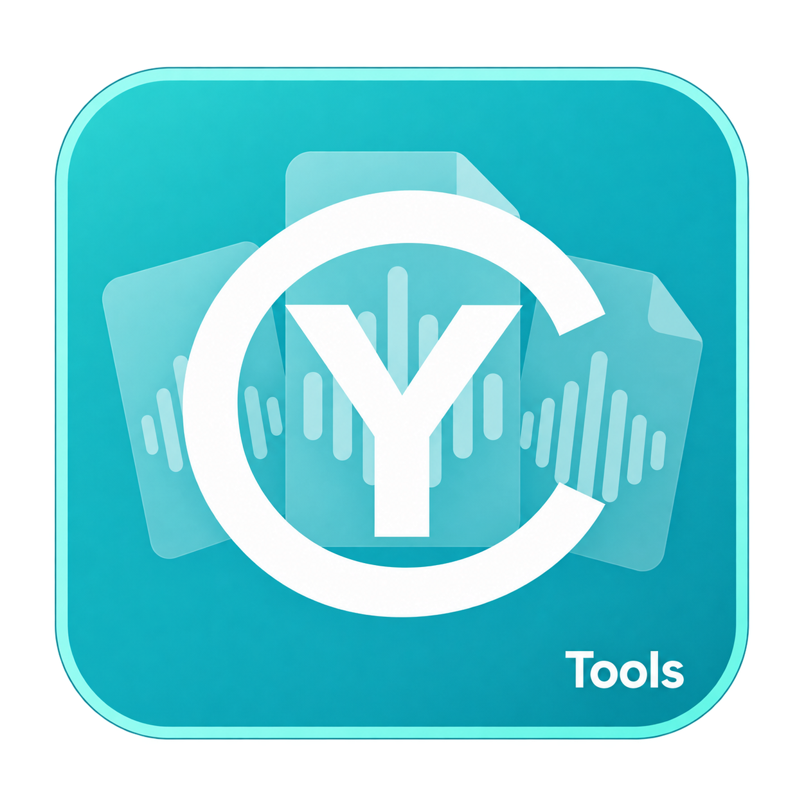
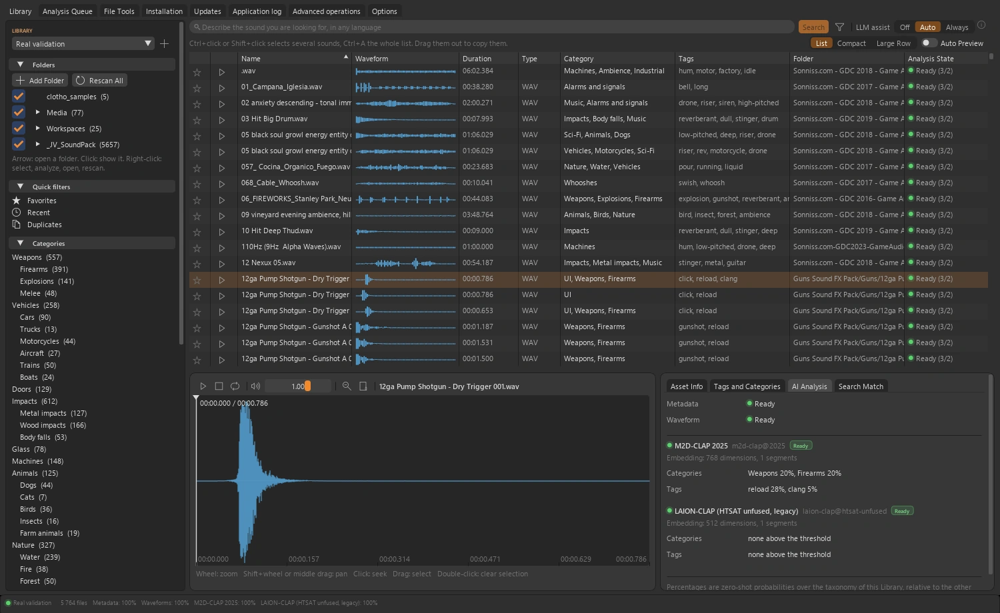
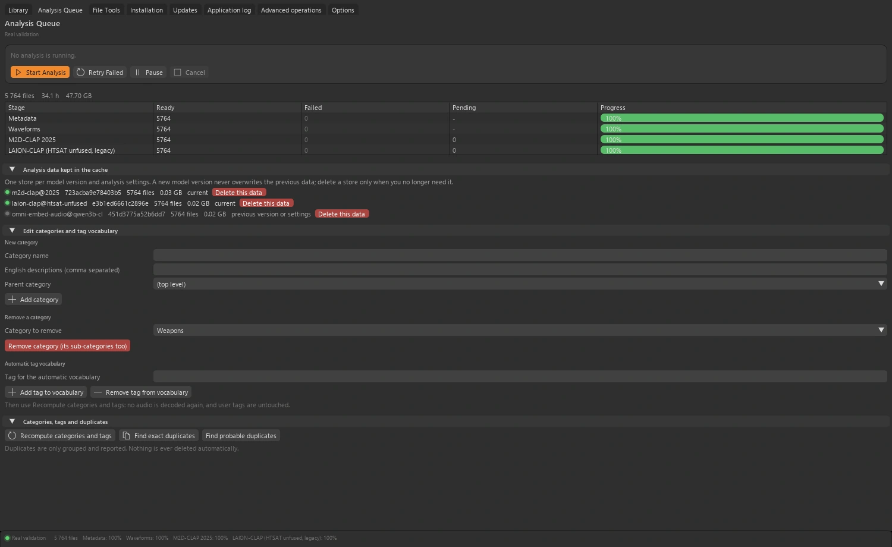

<table width="100%">
  <tr>
    <td width="300" align="left" valign="top">
      <a href="https://mrmybal.github.io/CyTools_AudioLibrary/">Website</a><br>
      <a href="https://mrmybal.github.io/CyTools_AudioLibrary/Documentation.html#/en/overview">Documentation</a><br>
      <a href="https://github.com/MrMybal/CyTools_AudioLibrary">GitHub</a><br><br>
      <sub>README</sub><br>
      <a href="README.md">English</a> · <a href="README.fr.md">Français</a>
    </td>
    <td width="400" align="center" valign="middle">
      <a href="https://mrmybal.github.io/CyTools_AudioLibrary/"></a>
    </td>
    <td width="300" align="right" valign="top">
      <p><sub>Application license</sub><br><a href="LICENSE"><strong>GPL-3.0-only</strong></a></p>
      <p><sub>Application version</sub><br><a href="VERSION.md"><strong>0.1.5</strong></a><br><strong>EXPERIMENTAL</strong></p>
      <p><a href="https://github.com/MrMybal/CyTools_AudioLibrary/releases/download/v0.1.5/CyTools_AudioLibrary-0.1.5-windows-x64.zip"><strong>Download</strong></a><br><sub>Windows x64 · portable</sub></p>
    </td>
  </tr>
</table>

<h1 align="center">CyTools AudioLibrary</h1>

Maintained by **Cyberalien**.


Explore your own sound collection with waveforms, tags and natural-language search. Your folders stay where they are. For sound designers, editors and anyone working with a growing collection of audio files.

> **EXPERIMENTAL · 0.1.5**
>
> Published Windows build for evaluation; some engine paths remain unvalidated. Read the [version notes and known limitations](VERSION.md).

[](website/assets/showcase/library.webp)

*Library workspace · folders, sound list, waveform and analysis.*


## The application

### Your collection

Add sound folders, browse their tree and listen directly from the waveform. Analysis data lives in a cache you choose, separate from the original audio.

### Semantic search

Compatible audio embedding models search the collection. When several models are enabled, rankings are combined rather than mixing incompatible embeddings. An optional local assistant can reformulate a request before search.

### Analysis & organisation

Follow each stage in the analysis queue, pause or resume work, and manage model-specific analysis stores. Tags, categories, notes and favourites belong to you and are preserved during analysis.

[](website/assets/showcase/queue.webp)

*Analysis queue · progress, analysis stores and taxonomy controls.*


## Features

- **Collection management:** folder references, waveform playback, filtering, tags, categories, notes, ratings and favourites on a sound, selection or folder.
- **Semantic search:** compatible M2D-CLAP, LAION-CLAP and Omni-Embed-Audio paths; rankings can be combined without mixing model embeddings.
- **Query preparation:** optional CySearchAssist-CLAP rewrites a request for audio search. It has its own model installation.
- **Analysis queue:** pause/resume, model-specific stores, taxonomy and background folder synchronisation. Analysis preserves user annotations.
- **File delivery:** export copied sounds as bundles or drag them to compatible applications. Explicitly confirmed File Tools can rename files or write metadata, with backup/undo safeguards.

**Desktop and automation:** English is the default interface language; French is selectable in Options. Save/load generation configurations, follow copyable application logs and use the declared operations through the CLI or MCP. The [manual](https://mrmybal.github.io/CyTools_AudioLibrary/Documentation.html#/en/overview) describes the real parameters and output contracts.

---

## Installation

The published application build is **Windows x64**. The portable ZIP includes its private Python runtime and base UI/media dependencies. Models and optional heavy engines are separate downloads.

1. [Download CyTools AudioLibrary 0.1.5](https://github.com/MrMybal/CyTools_AudioLibrary/releases/download/v0.1.5/CyTools_AudioLibrary-0.1.5-windows-x64.zip).
2. Extract the complete ZIP into a writable folder. Keep `app/` and `runtime/` beside the launcher.
3. Open **CyTools_AudioLibrary.exe**. Use the installation/model workspace for the components you need; review each component licence and any provider access conditions before download.

No machine Python is needed just to open the portable application. Source setup and some optional engine installers require additional tools such as Git. Keep the full release folder; the standalone `.exe` or an `app` update ZIP alone is not a complete installation.

Windows x64 is tested; the Linux launcher is unvalidated. Semantic search requires separately installed compatible models and the AI engine. Some model licences restrict commercial use. File Tools can rename files or write metadata only when explicitly requested.

### Updates and data

For an existing compatible installation, use its Updates page and the matching application update package. Keep `data/`, installed engines and models. An update for another runtime ABI must not be forced. If the required runtime changes, use the complete portable release in a separate folder and follow the migration instructions.

## Source, build and required libraries

<details>
<summary>Windows source setup and optional build tools</summary>


Use Python **3.11** for the base source environment. Git is needed for cloning and pinned Git requirements. Building the launcher needs the MSVC x64 Build Tools; use a developer command prompt.

```powershell
git clone https://github.com/MrMybal/CyTools_AudioLibrary.git
cd CyTools_AudioLibrary
powershell -File app\Install.ps1
powershell -File app\build_launcher.ps1
.\CyTools_AudioLibrary.exe
```

The exact base requirements are in [app/requirements.txt](app/requirements.txt). Engines use their own environments and model catalogues; installing the base environment does not install them. Follow the [developer setup](app/README.md) for the detailed build and optional components.

</details>

---

## License

**CyTools AudioLibrary is licensed under [GPL-3.0-only](LICENSE).** CyToolsCore, CyUI and CyDoc remain MIT components; their licences do not change the application licence. Optional engines, plugins and model weights retain their own terms.

### Main components and third-party libraries

| Library · source | License · terms | Use / scope |
| --- | --- | --- |
| [CyToolsCore 0.10.1](https://github.com/MrMybal/CyToolsCore) | [MIT](LICENCES/CyToolsCore-MIT.txt) | SDK/runtime: jobs, sessions, resources, CLI and MCP. |
| [CyUI 1.2.0](https://github.com/MrMybal/CyUI) | [MIT](LICENCES/CyUI-MIT.txt) | Selected bundled Python UI modules. |
| [CyDoc 0.1.0](https://github.com/MrMybal/CyDoc) | [MIT](LICENCES/CyDoc-MIT.txt) | Bundled offline reader; Node/npm are authoring/build tools only. |
| [Dear ImGui / imgui-bundle](https://github.com/pthom/imgui_bundle) | [MIT + component notices](https://github.com/pthom/imgui_bundle/blob/main/LICENSE) | Desktop renderer and its bundled native components. |
| [CPython 3.11](https://www.python.org/) | [PSF + component notices](https://docs.python.org/3.11/license.html) | Private runtime included in the Windows portable archive. |
| [NumPy / SciPy / Pillow](app/requirements.txt) | [BSD-3-Clause / MIT-CMU](LICENCES/SOURCES.txt) | Base audio/image processing. |
| [soundfile / sounddevice / PyAV](app/requirements.txt) | [BSD / MIT; native libraries retain their terms](app/licenses.json) | Decode, waveform playback and audio devices; libsndfile/FFmpeg notices remain applicable. |
| [Mutagen](https://github.com/quodlibet/mutagen) | [GPL-2.0-or-later](https://github.com/quodlibet/mutagen/blob/main/COPYING) | File Tools metadata writing, only on explicit confirmation. |
| [M2D](https://github.com/nttcslab/m2d) | [NTT Software License](https://github.com/nttcslab/m2d/blob/master/LICENSE.pdf) | Optional downloaded analysis source/runtime. |
| [Omni-Embed-Audio](https://github.com/JudeJiwoo/Omni-Embed-Audio) | [MIT (code); separate model terms](app/licenses.json) | Optional analysis backend; Qwen2.5-Omni backbone weights have non-commercial terms. |

This table indexes the main components; it does not replace their complete transitive notices. Retain [LICENCES/](LICENCES/), [app/licenses.json](app/licenses.json), the licences beside installed packages and the notices in each optional engine/model. CUDA libraries, when installed, also retain NVIDIA’s terms.

## References and links

- [Documentation](https://mrmybal.github.io/CyTools_AudioLibrary/Documentation.html#/en/overview)
- [Website](https://mrmybal.github.io/CyTools_AudioLibrary/)
- [Source repository](https://github.com/MrMybal/CyTools_AudioLibrary) · [Releases and checksums](https://github.com/MrMybal/CyTools_AudioLibrary/releases)
- [Issue tracker](https://github.com/MrMybal/CyTools_AudioLibrary/issues) · [Version notes](VERSION.md)
- [Developer setup](app/README.md)

<details>
<summary><strong>AI Usage</strong></summary>

- [Start here: project agent guide](app/AGENTS.md) — product rules and important files.
- [Operations and AI integration](app/Documentation/DocAI.md) — actual tool contracts and task usage.
- [Build this application](app/README.md) — source setup and application-specific commands.

</details>
